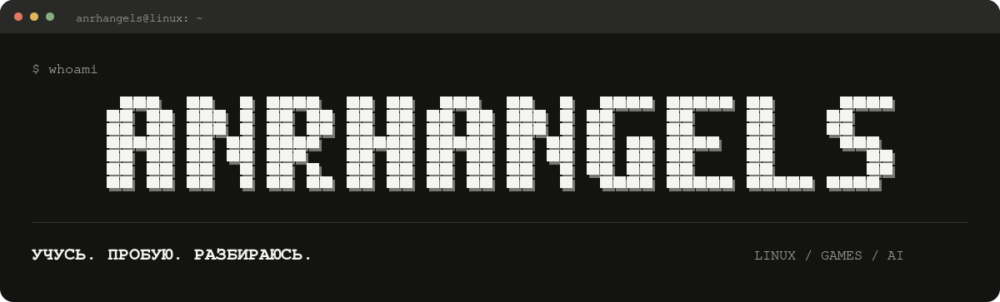
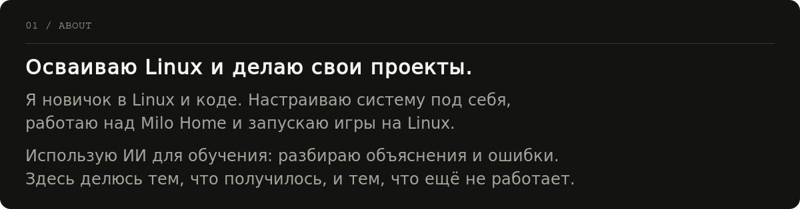
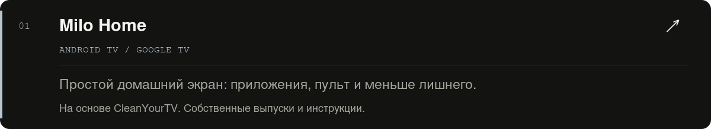
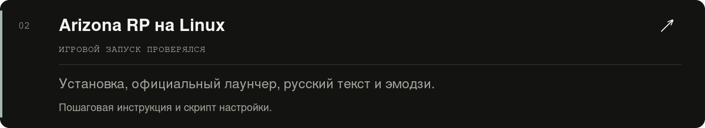
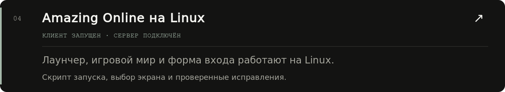
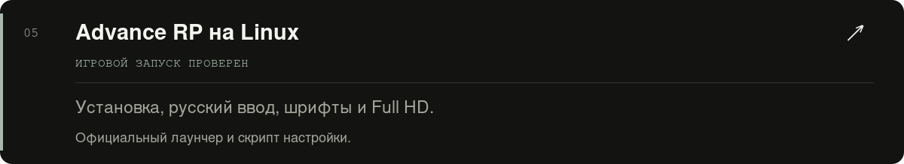
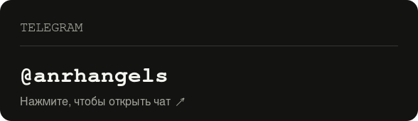
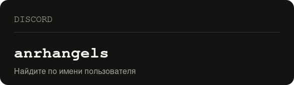

  

  
  

<a href="https://t.me/anrhangels">Telegram: @anrhangels</a> &nbsp; · &nbsp; Discord: <code>anrhangels</code>

Открыть текстовую версию профиля

Я новичок в Linux и коде. Учусь на практике: настраиваю систему, работаю над Milo Home, запускаю игры и записываю результаты. Использую ИИ для объяснений, помощи с кодом и разбора ошибок.

- [Milo Home](https://github.com/anrhangels/milo-home) — простой домашний экран для Android TV / Google TV, основанный на CleanYourTV.
- [Arizona RP на Linux](https://github.com/anrhangels/linux-arizona-rp) — инструкция и автоматическая настройка.
- [Radmir CRMP на Linux](https://github.com/anrhangels/linux-radmir-rp) — инструкция, графика и помощник музыки.
- [Amazing Online на Linux](https://github.com/anrhangels/linux-amazing-rp) — запуск клиента, подключение к серверу, единый установщик и автоматический выбор экрана.

- [Advance RP на Linux](https://github.com/anrhangels/linux-advance-rp) — инструкция, шрифты, русский ввод и Full HD.

Arizona, Radmir, Advance и Amazing запускаются в подготовленных окружениях Linux. В репозиториях — скрипты, пошаговые инструкции и разбор найденных ошибок.

Связь: [Telegram @anrhangels](https://t.me/anrhangels), Discord — `anrhangels`.

