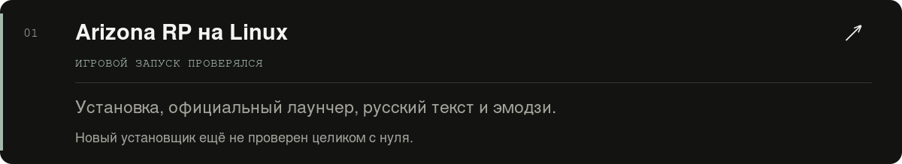
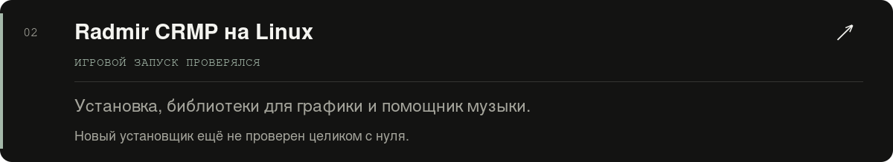
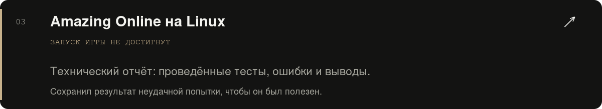

  

  <a href="#проекты">Проекты</a> · <a href="#обо-мне">Обо мне</a> · <a href="#контакт">Связаться</a>

Текстовая версия и ссылки

Я новичок в Linux и коде. Учусь на практике: настраиваю систему, запускаю игры и записываю результаты. Использую ИИ для объяснений, помощи с кодом и разбора ошибок.

- [Arizona RP на Linux](https://github.com/anrhangels/linux-arizona-rp) — инструкция и автоматическая настройка.
- [Radmir CRMP на Linux](https://github.com/anrhangels/linux-radmir-rp) — инструкция, графика и помощник музыки.
- [Amazing Online на Linux](https://github.com/anrhangels/linux-amazing-rp) — отчёт о неудачной попытке запуска.

Игровые запуски Arizona и Radmir проверялись на нашей системе. Полная установка с нуля новыми скриптами ещё не перепроверена в игре. Подробности и ограничения — в документации каждого проекта.

Работа над проектами и оформлением велась с помощью ИИ — OpenAI Codex GPT-6.1-Sol.

